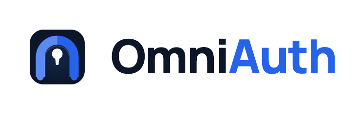

<p align="center">
  <picture>
    <source media="(prefers-color-scheme: dark)" srcset="docs/assets/omniauth-horizontal-dark.png" />
    
  </picture>
</p>

# OmniAuth Plugin

A Jenkins **security and access-governance platform**. OmniAuth combines flexible
authentication — **native username/password and OAuth2 / OIDC single sign-on** — with a
full suite of features for keeping Jenkins access **secure and easy to manage**: access
management, just-in-time elevation, access reviews, session control, emergency break-glass
access, audit logging, and notifications.

Single sign-on is built on a **pluggable provider framework**. **Microsoft Entra (Azure AD)
is the provider integrated today; more OAuth2/OIDC providers are planned.**

- **Artifact:** `io.jenkins.plugins:omni-auth` (packaging `hpi`)
- **Jenkins:** 2.541.2+ · **Java:** 21 · **Parent POM:** `org.jenkins-ci.plugins:plugin:4.80`
- **License:** MIT

---

## Why OmniAuth

OmniAuth is not just a way to sign in through an identity provider — it's the security and
management layer around Jenkins access:

- **Flexible authentication.** Native accounts and OAuth2/OIDC SSO on one login page, so
  human users, service accounts, and break-glass admins all have an appropriate path.
- **Least-privilege by design.** Scoped, time-limited, reviewable grants — with just-in-time
  elevation instead of standing privilege.
- **Operable and safe.** Session revocation, fail-closed password resets, MFA-protected
  break-glass recovery, and stale-account cleanup.
- **Accountable.** A full audit trail plus real-time notifications to email, Slack, and Teams.
- **Easy to manage.** A single console (**Manage Jenkins → OmniAuth**) for everything above.

## Feature overview

### Access management & governance
- Matrix-based authorization (`OmniAuthAuthorizationStrategy`) with grouped, labeled
  permissions and a friendlier admin experience.
- Per-user and **per-group** assignments, global or scoped to a job/folder via a tree picker
  (parent folders auto-granted Read).
- **Time-limited grants** with expiry dates, auto-revoked by a background worker.
- **Just-in-Time (JIT) access**: request time-bound elevation, approve/deny/revoke,
  auto-expire — no standing privilege.
- **Access review / certification**: a keep/revoke queue on a schedule, with a weekly digest.
- **Conflict detection** when scoped restrictions collide with global admin.
- Full **audit log** of every access change, with purge controls.

### Security & account safety
- **Session control**: active-session view and force logout / revocation.
- **Force password change** (fail-closed): no session on any path — form, BASIC, API token,
  CLI — until a new password is set.
- **Break Glass** emergency access protected by a TOTP second factor (QR enrollment).
- **Brute-force tracking** with a configurable threshold and alerting.
- **Stale-user** warning and cleanup workers (dry-run supported), with protected-user exemptions.

### Authentication
- Native username/password (bcrypt), inherited from Jenkins core — full API-token and CLI
  compatibility.
- OAuth2 / OIDC **single sign-on** via a pluggable provider framework, hardened with **PKCE**
  and **ID-token nonce** validation.
- **Microsoft Entra** is the currently integrated provider; identity is anchored to the
  stable directory object id and users are keyed by email for pre-provisioning.
- Optional **group synchronization** from the identity provider, surfaced as authorities for
  [group-based access](docs/administration/access-management.md).

### Notifications & experience
- Email (SMTP), Slack, and Microsoft Teams channels with per-event routing, retry, test
  actions, and email preview.
- Configurable, themeable **login page** branding.

> Full documentation lives in [`docs/`](docs/README.md).

---

## Requirements

- Jenkins **2.541.2** or newer (Jakarta servlet API line).
- **Java 21** (Amazon Corretto 21 is the tested runtime).
- For SSO: an OAuth2 / OIDC identity provider. **Microsoft Entra** is supported today — see
  [Microsoft Entra setup](docs/administration/entra-setup.md).

Bundled/relied-upon plugins include Matrix Authorization Strategy, CloudBees Folder
(folder-scoped grants), and Jakarta Mail API (notifications).

## Getting started

1. **Install** — deploy `target/omni-auth.hpi` via **Manage Jenkins → Plugins → Advanced →
   Deploy Plugin**, then restart.
2. **Enable** — **Manage Jenkins → Security → Security Realm → OmniAuth**, and select the
   **OmniAuth Authorization Strategy** to unlock access management.
3. **Connect SSO (optional)** — configure your OAuth2/OIDC provider. For Microsoft Entra,
   follow [Entra setup](docs/administration/entra-setup.md).
4. **Manage** — everything else lives under **Manage Jenkins → OmniAuth**.

See the [Quick start](docs/getting-started/quick-start.md) for a 15-minute walkthrough.

## Configuration as Code (JCasC)

Core descriptors expose `@Symbol` names for JCasC:

| Symbol | Component |
|---|---|
| `omniAuth` | Security realm |
| `entraConfig` | OAuth provider config (Microsoft Entra) |
| `omniAuthAuthorization` | Authorization strategy |
| `omniAuthAssignments` | Access assignments store |
| `omniAuthRoles` | Role definitions |
| `omniAuthJitRequests` | JIT request store |

See [Configuration as Code](docs/operations/configuration-as-code.md).

## Building from source

```bash
export JAVA_HOME=/path/to/jdk-21
mvn package -DskipTests   # produces target/omni-auth.hpi
```

**Build notes** (already configured in `pom.xml`): the Jenkins license-maven-plugin and
Spotless checks are skipped because their Groovy/ASM stack cannot parse some newer class
files on Maven 3.9.13's classpath.

### Running for development

`mvn hpi:run` is not used here (its embedded Jetty does not register the Jenkins
web-fragment). Instead run the standalone WAR against a local `JENKINS_HOME`:

```bash
JENKINS_HOME=./work \
  java -jar jenkins-war-2.541.2.war --httpPort=9090 --prefix=/jenkins
# → http://localhost:9090/jenkins/
```

See [Building & contributing](docs/developer/contributing.md) for the full developer guide.

---

## Issues

Report issues and enhancements in the
[Jenkins issue tracker](https://issues.jenkins.io/).

## Contributing

Refer to the Jenkins
[contribution guidelines](https://github.com/jenkinsci/.github/blob/master/CONTRIBUTING.md).

## License

Licensed under MIT, see [LICENSE](LICENSE.md).
