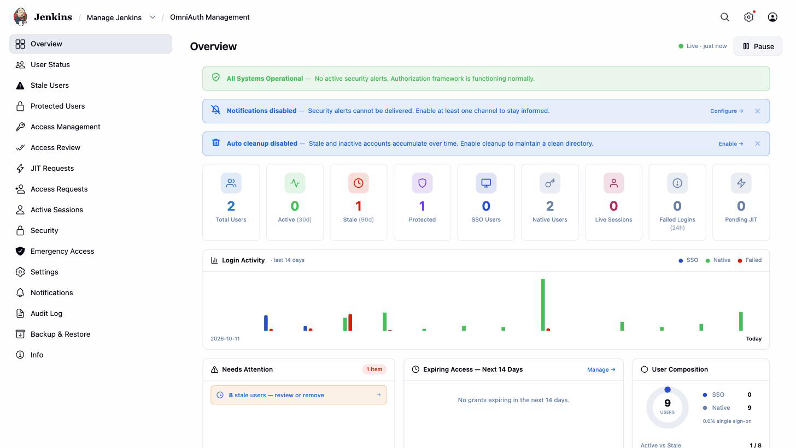
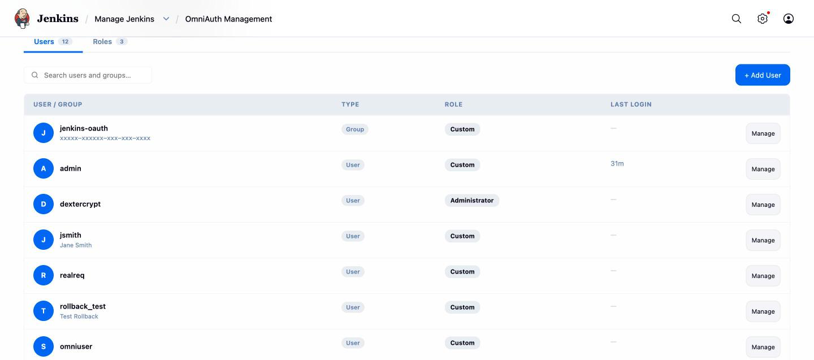
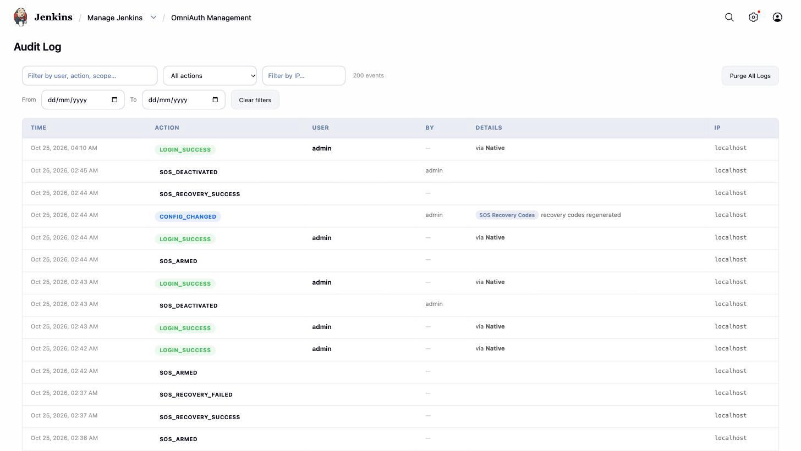
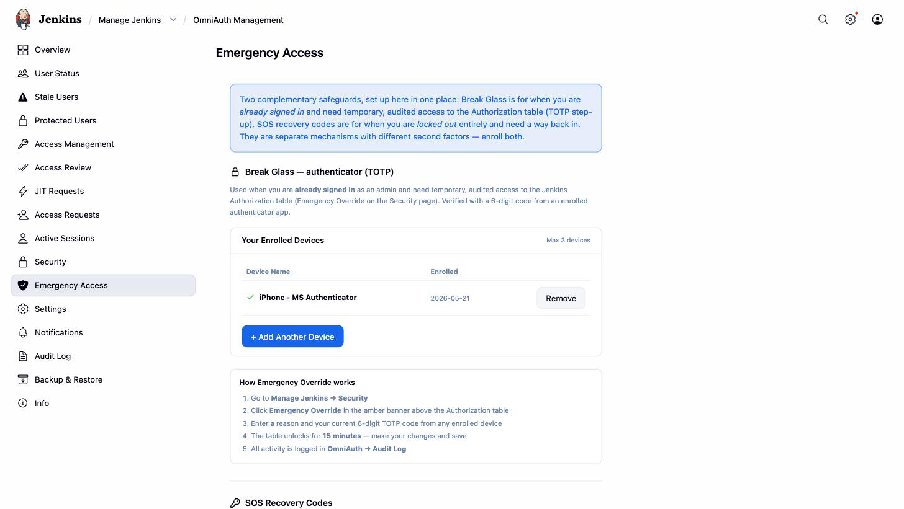
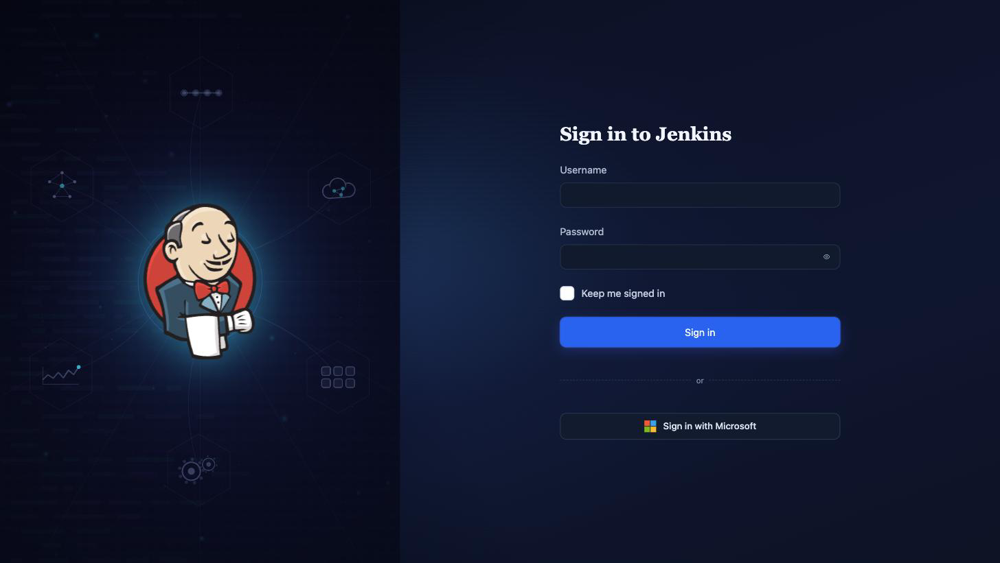

<p align="center">
  <picture>
    <source media="(prefers-color-scheme: dark)" srcset="docs/assets/omniauth-horizontal-dark.png" />
    
  </picture>
</p>

<h1 align="center">Jenkins access governance — not just single sign-on</h1>

<p align="center">
  <b>OmniAuth</b> is a Jenkins security plugin that goes past the login page: single sign-on <em>and</em>
  a full access-governance layer — least-privilege grants, just-in-time elevation, access reviews,
  break-glass, lockout recovery, and a complete audit trail — in one console.
</p>

<p align="center">
  
  
  
  
  
</p>

---

## Why this exists

Most Jenkins security plugins stop at the front door: they log a user in, and that's it. But signing
in is the *easy* part — the hard part is everything after: who can do what, for how long, who approved
it, who reviewed it, and how you get back in when it all goes wrong.

OmniAuth is that "everything after." It's the layer that turns Jenkins authentication into **managed,
least-privilege, auditable access** — the kind of controls a security or compliance team expects, in a
single plugin instead of a sprawling platform.

| Most SSO plugins give you… | OmniAuth adds… |
|---|---|
| A login via your IdP | …plus a governance console for everything after login |
| A static permission matrix | …scoped, **time-limited**, auto-expiring grants + a friendlier matrix |
| "You're an admin, forever" | …**just-in-time** elevation with approval, instead of standing privilege |
| No review process | …scheduled **access reviews** / certification with a weekly digest |
| Hope you don't get locked out | …**break-glass** step-up *and* **SOS** lockout recovery |
| Partial logging | …a **full audit trail** with retention, plus email/Slack/Teams alerts |

> **Enterprise SSO with Microsoft Entra (Azure AD) today**, with more OAuth2/OIDC providers on the
> roadmap. The governance layer sits above authentication, so its full depth applies to every user —
> native or SSO — however they sign in.

---

## A look inside

<table>
  <tr>
    <td width="50%" valign="top">
      <br/>
      <sub><b>Overview</b> — live KPIs, 14-day login activity, Needs&nbsp;Attention</sub>
    </td>
    <td width="50%" valign="top">
      <br/>
      <sub><b>Access Management</b> — scoped, time-limited grants via a tree picker</sub>
    </td>
  </tr>
  <tr>
    <td width="50%" valign="top">
      <br/>
      <sub><b>Audit log</b> — every security action, filterable and retained</sub>
    </td>
    <td width="50%" valign="top">
      <br/>
      <sub><b>Emergency Access</b> — Break Glass (TOTP) + SOS recovery codes</sub>
    </td>
  </tr>
</table>

<p align="center">
  <br/>
  <sub><b>Branded sign-in</b> — native accounts and SSO on one page</sub>
</p>

---

## What's inside

### 🛡️ Access management & governance
- **Matrix-based authorization** (`OmniAuthAuthorizationStrategy`) with grouped, labeled permissions
  and a friendlier admin experience than the raw Jenkins matrix.
- **Per-user and per-group** assignments — global, or scoped to a job/folder via a tree picker
  (parent folders auto-granted Read).
- **Time-limited grants** with expiry dates, auto-revoked by a background worker.
- **Just-in-Time (JIT) access** — request time-bound elevation, multi-approver approve/deny/revoke,
  auto-expire. No standing privilege.
- **Access review / certification** — a keep/revoke queue on a schedule, with a weekly digest.
- **Conflict detection** when scoped restrictions collide with global admin.
- A **full audit log** of every state-changing and security action, with configurable retention.

### 🚨 Account safety & recovery
- **Break Glass** — a TOTP (6-digit) step-up an already-signed-in admin activates for a 15-minute
  window before sensitive actions; multi-device enrollment (up to 3).
- **SOS Mode** — a true **lockout recovery** path for when no admin can sign in (SSO down, or the
  authorization strategy broke). A host-dropped trigger file arms a 30-minute window at
  `/sos/recover`; a single-use **recovery code** (stored only as a salted hash) signs the admin back
  in and restores admin. Hardened with a *realm gate* so idle installs can't be a backdoor.
- **Brute-force lockout** (enforced) — past a configurable threshold an account is locked for a
  cooldown window, with alerting; protected users exempt.
- **Session control** — active-session view and force logout / revocation.
- **Force password change** (fail-closed) — no session on any path (form, BASIC, API token, CLI)
  until a new password is set.
- **Stale-user** warning + cleanup workers (dry-run supported), with protected-user exemptions.

### 🔐 Authentication
- **Native** username/password (bcrypt), inherited from Jenkins core — full API-token and CLI
  compatibility.
- **OAuth2 / OIDC single sign-on** (currently Microsoft Entra), always hardened with **PKCE** and
  **ID-token nonce** validation; identity anchored to the stable directory object id.
- **Test Connection** button validates tenant / client ID / secret against Microsoft before saving.
- **Allowed email domains** — restrict SSO sign-in to listed domains, even for pre-provisioned users.
- Optional **group synchronization** from the identity provider, surfaced as authorities.
- **Provisioning portal** — anonymous access requests → admin approval queue → time-limited accounts.

### 📣 Notifications & experience
- **Email (SMTP), Slack, and Microsoft Teams** with per-event routing, retry, test actions, preview.
- Configurable, themeable **login page** branding.
- A single console — **Manage Jenkins → OmniAuth** — for all of the above.

> Full documentation lives in [`docs/`](docs/README.md).

---

## Requirements

- Jenkins **2.541.2+** (Jakarta servlet API line) · **Java 21** (tested on Amazon Corretto 21).
- For SSO: an OAuth2/OIDC provider — **Microsoft Entra** today
  ([setup](docs/administration/entra-setup.md)).

Relies on Matrix Authorization Strategy, CloudBees Folder (folder-scoped grants), and Jakarta Mail.

## Getting started

1. **Install** — deploy `target/omni-auth.hpi` via **Manage Jenkins → Plugins → Advanced → Deploy
   Plugin**, then restart.
2. **Enable** — **Manage Jenkins → Security → Security Realm → OmniAuth**, and select the **OmniAuth
   Authorization Strategy** to unlock access management.
3. **Connect SSO (optional)** — for Microsoft Entra, follow [Entra setup](docs/administration/entra-setup.md).
4. **Manage** — everything else lives under **Manage Jenkins → OmniAuth**.

See the [Quick start](docs/getting-started/quick-start.md) for a 15-minute walkthrough.

## Configuration as Code (JCasC)

Core descriptors expose `@Symbol` names for JCasC:

| Symbol | Component |
|---|---|
| `omniAuth` | Security realm |
| `entraConfig` | OAuth provider config (Microsoft Entra) |
| `omniAuthAuthorization` | Authorization strategy |
| `omniAuthAssignments` | Access assignments store |
| `omniAuthRoles` | Role definitions |
| `omniAuthJitRequests` | JIT request store |
| `omniAuthProvisioningRequests` | Provisioning request store |

Global settings (brute-force lockout, cleanup, notifications, branding, audit retention, SOS) round-trip
under the global-configuration descriptor; the Entra block includes `allowedDomains`. See
[Configuration as Code](docs/operations/configuration-as-code.md).

## Building from source

```bash
export JAVA_HOME=/path/to/jdk-21
mvn package -DskipTests   # produces target/omni-auth.hpi
```

### Running for development

```bash
JENKINS_HOME=./work \
  java -jar jenkins-war-2.541.2.war --httpPort=9090 --prefix=/jenkins
# → http://localhost:9090/jenkins/
```

See [Building & contributing](docs/developer/contributing.md) for the full developer guide.

---

## Issues & contributing

- Report issues and enhancements in the [Jenkins issue tracker](https://issues.jenkins.io/).
- Contributions welcome — see the Jenkins
  [contribution guidelines](https://github.com/jenkinsci/.github/blob/master/CONTRIBUTING.md).

## License

Licensed under **MIT** — see [LICENSE](LICENSE.md).
